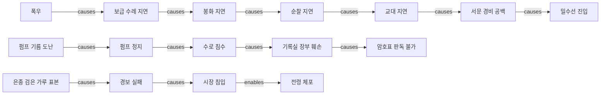

# 게임 관계도 벤치마크: 검은 항구의 밤

5회차 가상 TRPG 플레이에서 정체 공개, 동명이인, 다단계 인과, 소문 정정과 기억 삭제를 검증한다. 실제 플레이 로그가 아닌 수작업 합성 개발용 세트다.

- 원본: [gameplay-graph.fixture.json](gameplay-graph.fixture.json)
- 실행기: [benchmark-gameplay.ts](../scripts/benchmark-gameplay.ts)
- 오프라인 결과: [gameplay-offline-result.json](gameplay-offline-result.json)
- 실제 API 호출·실패 결과: [gameplay-openrouter-result.json](gameplay-openrouter-result.json)
- Entity 생명주기·정답 그래프 검사: [gameplay-benchmark.test.ts](../tests/gameplay-benchmark.test.ts)

## 데이터와 실행

주 캠페인에 Entity 30개와 원본 Memory 60개, 별도 캠페인에 Entity 1개와 Memory 2개를 둔다. 정정 2회, 삭제 1회, 명시적 Mention 연결 1회를 적용하면 총 Memory 64개, Evidence 8개, Link 134개다. 세션 순서대로 공개 API를 통해 저장하며, 아직 생성되지 않은 Entity를 미리 넣지 않는다.

질문은 인과 14개, 관계 3개, 정체 3개, 시간 2개, 부정 대조군 5개다. 별도 인물 판별 6개는 공개된 정체·별명·동명이인·신규 NPC·근거 부족을 포함한다. 후보의 이름과 metadata만 현재 제품의 후보 계약대로 제공하고, 해당 회차 이후 정보와 정답 ID는 모델 입력에서 제외한다. unknown은 후보 선택 보류이며 새로운 Entity를 자동 생성하라는 의미가 아니다.

```bash
npm run benchmark:gameplay
# 환경변수 OPENROUTER_API_KEY를 설정한 뒤 실제 모델 비교
npm run benchmark:gameplay -- --live
npm test
```

오프라인은 외부 API를 호출하지 않는다. `--live`는 지정된 임베딩과 Decision 모델만 사용하고, 사용할 수 없는 비교는 생략하거나 fallback임을 기록한다. Provider 실패가 있으면 결과를 저장하고 종료 코드 1을 반환한다. 프록시 환경에서는 Node.js 24의 `NODE_USE_ENV_PROXY=1`을 사용한다.

## 관계도 예시



간선은 fixture에서 명시적으로 입력한 게임 세계의 정답이다. 공통 원인에 따른 별도 분기, 관계만 있고 인과 간선은 없는 대조군도 있다. 단순한 시간 순서나 연결성을 인과로 계산하지 않는다.

## 측정 결과

2026-10-05, Node.js 24.19.0, 반환 상한 20개·본문 예산 12,000자. 모델 입력이나 검색 후보에 정답 ID를 넣지 않았다. 상위 5개 근거 회수율과 첫 근거의 역순위 평균(MRR)도 별도로 측정한다. 실측 검색 시간은 미리 배치한 질의 임베딩 호출과 API 제한을 위한 대기 시간을 제외하며, Decision 요청 시간은 포함한다.

| 지표 | 어휘 | 임베딩 하이브리드 | + Decision 재정렬 |
|---|---:|---:|---:|
| 필수 근거 회수율 @20 | 74.4% | 94.3% | 94.3% |
| 필수 근거 회수율 @5 | 64.7% | 76.3% | 86.3% |
| 첫 결과가 정답 근거인 비율 | 63.0% | 77.8% | 92.6% |
| 첫 근거 역순위 평균(MRR) | 0.695 | 0.859 | 0.957 |
| 모든 필수 근거를 회수한 질문 | 17/27 | 23/27 | 23/27 |
| 정답 경로의 모든 노드를 회수한 경로 | 7/15 | 11/15 | 11/15 |
| 검색 요청 p95 시간 | 3 ms | 32 ms | 1,667 ms |

임베딩으로 회수되는 근거가 늘었고 Decision은 같은 20개 후보의 순위를 개선했다. 재정렬로 누락된 경로 노드가 새로 생기는 것은 아니다. 이 작은 합성 세트에 대한 결과로 일반적인 모델 성능을 뜻하지 않는다.

어휘 검색에서 최종 사건만 묻는 장거리 질문 두 개의 근거 회수율은 57.1%, 40.0%였다. 하이브리드와 Decision에서도 두 질문은 각각 57.1%, 40.0%로 그대로였다. 의미 검색과 재정렬만으로 긴 사슬의 누락이 해결되지 않았다. 구조화된 방향성 다단계 탐색의 회귀 기준으로 사용한다.

실제 모델은 `nvidia/nemotron-3-embed-1b:free`(2048차원)와 `inception/mercury-decide:free`다. 활성 Memory 59개 색인, 27개 질의 임베딩 배치, Decision 검색 27회와 인물 판별 6회를 완료했다. **최종 실행의 38회 API 응답은 모두 HTTP 200이고 Provider fallback은 0회**다. 응답이 보고한 비용 합계는 0달러이며, 이번 실행은 비용 메타데이터 누락도 없다.

인물 판별은 **6/6 정답**, 근거 부족·새 NPC·정체 모호 사례 3개 모두 unknown으로 유지해 잘못된 병합 0회였다. 공개된 정체, 확인된 별명, 동명이인 역할 구분을 맞혔다. 이름과 명시된 metadata에 대한 후보 선택 결과이며 자동 Entity 생성·자동 Mention 확정을 수행하지 않았다.

조회의 읽기 전용, Space 격리, 비활성 Memory 제외는 세 모드 모두 통과했다. 하이브리드와 Decision은 부정 대조군에서 제외 대상으로 라벨링한 동시 관측 Memory `m_s01_12`를 1회 반환했다. 이는 검색 문맥에 상관관계 관측이 포함됐다는 진단으로, 인과를 주장했다는 의미는 아니다. 이 항목은 Space나 lifecycle 위반도 아니다.

첫 시도는 계정 ZDR 정책의 HTTP 404, 이후 첫 재시도는 일부 HTTP 429로 막혔다. 사용자가 ZDR 설정을 바꾼 뒤 Decision 호출 간격을 3.5초로 두어 최종 비교를 완료했다. 위 표와 JSON은 최종 성공 실행만 기록한다.

## 점수의 의미와 다음 개선

필수 근거 회수율은 질문별 정답 Memory의 회수 비율이다. 최소 정답 대비 precision은 유용한 추가 문맥도 비정답으로 셀 수 있어 보조 지표로만 사용한다. 빈 정답은 전체 평균 회수율에서 제외한다. 경로 점수는 반환된 Memory가 정답 경로의 노드를 전부 포함하고 저장된 방향·`causes`/`enables` 간선이 일치하는지 검사한다.

현재 API는 구조화된 인과 경로나 답변을 반환하지 않는다. **경로 노드 회수는 인과 추론 성공이나 답변 정확도가 아니다.** 부정 대조군 역시 금지 항목 회수 여부를 측정하며 자연어 답변의 환각 여부를 채점하지 않는다.

Entity 생성은 Agent/호스트의 명시적 구조화 입력으로 수행한다. 새 ID 생성·동명이인 분리·unknown에서 임의 Entity 생성 방지·명시적 Mention 연결·멱등성·다른 Space 연결 거부·재시작 지속성은 7개 생명주기 테스트로 검증했다. 그래프·채점 테스트 5개를 더해 전체 프로젝트 테스트 69개가 통과했다.

다음 개선은 방향과 관계 타입을 유지하는 다단계 탐색, 경로별 출처 반환, 시간 범위 질문의 검색 개선이다. 별도의 답변 생성 기능을 붙일 때에는 필수 근거 회수와 인과 답변 정확도를 각각 채점해야 한다.
