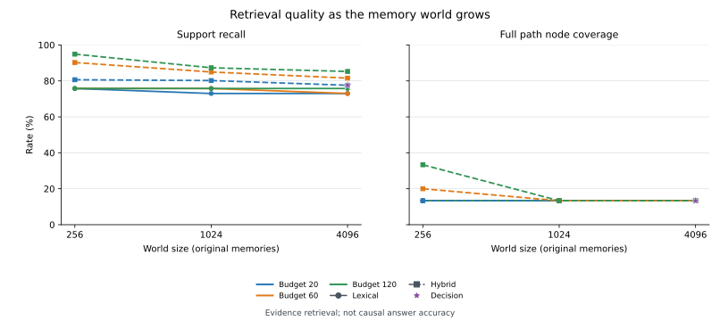

# 대형 월드·긴 문맥 스트레스 벤치마크

2026-10-05, Node.js 24.19.0. 이전 60개 기억의 세트에서 확장해 64회차·최대 4,096개 원본 기억과 1,038개 Entity를 시험했다. 질문과 정답을 유지한 채 월드 크기와 검색 문맥 예산을 각각 바꿔 비교한다.

## 데이터와 재현

- [결정적 월드 생성기](../scripts/world-stress-fixture.ts): 시드 20261005, 규모 256·1,024·4,096
- [검색 실행기](../scripts/benchmark-world-stress.ts), [순수 채점·provenance](../scripts/world-stress-lib.ts)
- [오프라인 결과](world-stress-offline-result.json), [실제 모델 결과](world-stress-openrouter-result.json)
- [긴 문맥 생성기](../scripts/world-context-probes.ts), [6.4만 문자 추가 실험](world-context-64000-result.json)
- [검증](../tests/world-stress.test.ts), [그래프 생성기](../scripts/plot-world-stress.py)

```bash
npm run benchmark:world
# OPENROUTER_API_KEY를 설정한 후 실제 모델 호출
npm run benchmark:world -- --live
# 6.4만 문자 문맥의 위치별 추가 호출
npm run benchmark:context
npm test
# 선택 시각화 도구: Python + matplotlib
python scripts/plot-world-stress.py
```

프록시 환경은 Node.js 24의 `NODE_USE_ENV_PROXY=1`을 사용한다. 라이브 실행은 `/tmp/context-memory-world-stress-v1`에 모델·본문 해시별 벡터와 fixture 해시별 SQLite를 캐시해 재시도 시 완료된 색인을 재사용한다. 키는 캐시나 결과에 저장하지 않는다. API가 거절한 문맥 프로필이 있으면 검색 결과를 저장하고 종료 코드 1을 반환한다.

핵심은 수작업 사건 96개, 명시적 후속 record 1개, 시드 기반 방해 사건이다. 최대 월드는 방해 사건 3,999개와 생성 Entity 1,000개를 포함한다. 방해 사건은 8종의 지역·운송·문서·장비 템플릿에서 이름·번호·지역을 바꾸며, 작은 월드가 큰 월드의 접두 집합이 되도록 생성했다. 같은 핵심 사건과 gold, 시점별 인물 정보를 유지한다. 이는 합성 데이터의 통제된 규모 실험이며 한 개 시드의 결과다.

네 개 인과 사슬은 각각 8단계이며 정전에서 갈라지는 공통 원인 분기를 더했다. 세 사슬을 함께 묻는 질문은 필수 근거 27개라 반환 상한 20개일 때 이론상 회수율 상한이 74.1%다. 총 질문은 인과 12·관계 8·정체 6·시간 4·부정 대조군 6개, 별도 인물 판별은 12개다. 정정·삭제·미해결 Mention 연결과 다른 Space 두 개도 포함한다.

세션 순서대로 공개 Record/Correct/Forget/Resolve API로 저장한다. 미래 Entity 참조를 선입력하지 않는다. 모델 호출 전에 fixture와 gold manifest SHA-256을 기록하고, 정답 ID·경로를 검색 또는 모델 후보에 주입하지 않는다.

| 원본 기억 | Entity | 활성 기억 | 활성 본문 문자 | 본문·Evidence·이름 총 UTF-8 bytes |
|---|---:|---:|---:|---:|
| 256 | 78 | 255 | 12,101 | 61,584 |
| 1,024 | 270 | 1,023 | 52,387 | 256,591 |
| 4,096 | 1,038 | 4,095 | 213,819 | 1,043,734 |

최대 월드의 활성 본문은 약 21.4만 문자다. Evidence와 이름까지 합하면 약 45.1만 문자이며, 원본 Evidence와 파생 Memory에 같은 사실이 반복될 수 있다. 문자 수를 토큰 수로 환산하지 않았다.

## 실제 검색 결과

임베딩은 `nvidia/nemotron-3-embed-1b:free`(2048차원), Decision은 `inception/mercury-decide:free`를 사용했다. 색인은 공개 Worker의 batch 128을 사용했고, 질의 벡터는 동일 모델·본문 해시로 캐시해 모든 규모와 예산에서 재사용했다. 각 결과의 Memory 본문·data와 Evidence 예산은 20개/12,000자, 60개/36,000자, 120개/72,000자다.

| 월드 원본 기억 | 반환 상한 | 어휘 근거 회수율 | 하이브리드 근거 회수율 | 어휘 경로 노드 전체 회수 | 하이브리드 경로 노드 전체 회수 |
|---|---:|---:|---:|---:|---:|
| 256 | 20 | 75.8% | 80.6% | 2/15 | 2/15 |
| 256 | 60 | 75.8% | 90.2% | 2/15 | 3/15 |
| 256 | 120 | 75.8% | 94.9% | 2/15 | 5/15 |
| 1,024 | 20 | 73.0% | 80.2% | 2/15 | 2/15 |
| 1,024 | 60 | 75.8% | 84.9% | 2/15 | 2/15 |
| 1,024 | 120 | 75.8% | 87.3% | 2/15 | 2/15 |
| 4,096 | 20 | 73.0% | 77.6% | 2/15 | 2/15 |
| 4,096 | 60 | 73.0% | 81.5% | 2/15 | 2/15 |
| 4,096 | 120 | 75.8% | 85.2% | 2/15 | 2/15 |



표의 경로 수는 질문별 정답 경로 15개이며 같은 사슬이 여러 질문에 사용된다. 네 개의 독립된 장거리 사슬과 짧은 부분 경로를 함께 측정한다. 경로 노드 회수는 구조화된 인과 답변 정확도가 아니다.

4,096개 월드에서는 문맥을 20→120개로 늘려도 하이브리드 근거 회수율이 77.6%→85.2%인 반면, 경로 전체 회수는 2/15에 머물렀다. 현재 한 단계 링크 확장과 최대 200개 벡터 후보 안에서 빠진 사건을 반환 예산만 늘려 회복하기 어렵다. 작은 월드는 120개 예산에서 5/15 경로를 회수해 규모에 따른 차이도 드러났다.

최대 월드의 20개 후보에 Decision 재정렬을 적용하면 상위 5개 근거 회수율은 **54.2%→60.5%**로 개선됐지만, 첫 결과가 정답 근거인 비율은 **83.3%→75.0%**로 내려갔다. 재정렬의 효과는 지표마다 달랐다. 전체 근거 회수율은 77.6%, 전체 경로 회수는 2/15로 유지됐다. 큰 예산의 Decision 비교는 구현의 20개 후보 제한 때문에 수행하지 않았다.

18개 어휘/하이브리드 설정과 1개 Decision 설정에서 Provider fallback은 0회였다. 조회의 읽기 전용, Space 격리, 비활성·명시적 제외 기억의 반환 방지 검사는 통과했다. `runtime_ms`에는 로컬 검색과 API 대기 간격이 포함되며, `network.ms`가 실제 HTTP 시간이다. 임베딩 네트워크 시간은 색인·질의 캐시 준비 기록에서 확인한다.

## 인물 판별: 후보 발견과 모델 선택을 분리

큰 월드에서 제품의 기본 후보 조회인 `ORDER BY id LIMIT 20`을 적용하고, 해당 세션까지 알려진 이름·metadata로 typed choice를 호출했다. fixture의 정답 포함 수동 후보 목록은 모델에 넘기지 않았다.

- 알려진 신원 8개 중 정답 Entity가 기본 후보에 존재한 경우: **2/8**
- 후보에 존재한 신원 선택: **2/2 정답**
- 근거 부족·새 NPC·초기 미공개 신원: **4/4 unknown 유지**
- 전체 신원 판별 성공: **6/12**
- 후보 밖 신원을 포함해 제공된 근거에 충실한 선택: **12/12**, 잘못된 Entity 선택 0회

나머지 알려진 인물 6명은 후보 발견 단계에서 빠졌다. 이전의 정답 포함 후보 6개 실험과 비교할 때 조건이 달라졌다. 대형 월드에서는 모델 판별에 앞서 이름·별명·속성으로 후보를 찾는 과정이 필요하다. Entity 생성은 명시적인 구조화 입력으로 수행하며 이 실험이 자동 Entity 추출이나 병합을 추가하지는 않는다.

## 긴 문맥에서 단서 위치와 API 경계

독립된 제어 실험은 두 인과 가지(9·10단계), 비슷한 이름의 두 인물, 신원 근거가 없는 전령을 포함한다. 크기별로 **동일한 방해 로그·동일한 핵심 블록**을 앞·중간·끝으로 옮긴다. 선택지에는 구체적인 후보만 적고, 정답을 암시하는 “최초 원인으로 확인됨” 같은 라벨은 제거했다. 빈 문맥 대조군도 수행했다.

| 요청 문맥 | 위치 | 관측 |
|---|---|---|
| 증거 없음 | 대조군 | 3/3 미확인 선택 |
| 32,000 문자 | 앞·중간·끝 | API 3회 성공, typed 판별 **9/9 정답** |
| 64,000 문자 | 앞·중간·끝 | API 3회 모두 HTTP 422, 판별 미측정 |
| 96,000 문자 | 앞·중간·끝 | API 3회 모두 HTTP 422, 판별 미측정 |

32k의 결과는 같은 좁은 질문 3개를 위치 3조건에서 반복한 값이다. 대형 월드의 전체 인과 QA 성능으로 일반화할 수 없다. 64k/96k는 추론 오답으로 계산하지 않았다. 별도 curl 요청도 96k에서 `Decision service could not complete the request`라는 일반적인 upstream 오류를 반환했다. 정확한 문자·byte·토큰 한계나 원인은 응답에 공개되지 않았고, Decision 응답은 prompt token 수도 제공하지 않았다.

주 실행 기록은 88회 API 호출 중 85회 HTTP 200·3회 HTTP 422이며, 별도 64k 실행의 3회는 모두 HTTP 422다. 성공 응답이 보고한 비용은 모두 0달러이고, 거절 응답의 비용 정보는 없다. 두 결과 파일은 API 거절과 검색 성능을 분리해 보존했다.

## 검증과 개선 우선순위

TypeScript 빌드와 전체 **75개 테스트**가 통과했다. 추가 6개 테스트는 결정적·중첩 데이터, 순차 API 저장, 시점별 Entity 존재, 예산별 조회 불변성, 방향을 뒤집은 간선·related_to의 인과 오인 방지, 긴 문맥 배경 동일성과 gold 암시 제거를 검증한다.

먼저 방향·관계 타입·시간·lifecycle·Space를 유지하는 다단계 경로 탐색과 경로별 출처 반환이 필요하다. 다음은 전 월드에서 Entity 이름·확인된 별명·속성으로 후보를 검색하는 단계다. 대형 벡터 전수 검색의 비용도 함께 측정해 인덱스 기반 구현을 검토한다. 자연어 답변 생성이 추가되면 현재의 근거 회수와 실제 인과 답변 정확도를 별도 채점한다.
